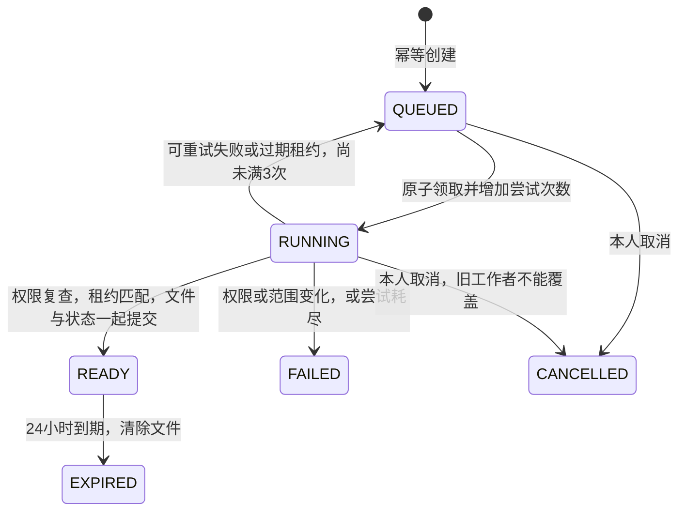

# 月度报表中心设计

日期：2026-10-26。使用者为员工、部门主管和管理员。问题是原导出只有事件，不能复核完整日结果，且缺少持久化导出任务。保留现有 Java、MySQL、Vue 和 POI。

## 范围与流程

员工选择月份查看本人月报；主管或管理员选择一个有权访问的部门，查看其当前在职员工档案人员的月报。预览展示汇总、逐人统计及逐日依据；用户创建导出任务，任务生成 XLSX，用户在有效期内鉴权下载。任务可取消，失败可重建，进程重启后通过租约恢复未完成任务。

首版仅 SELF（本人）与 DEPARTMENT（选定部门），部门必须明确选择，不支持跨部门全量导出。部门当前员工人数上限50，超过时明确拒绝，不截断。部门报表以当前在职员工档案为人员基准，再按每日历史归属过滤；不是完整历史花名册月报。已停用人员和调出人员不自动纳入当前部门报表，后续历史组织模型单独设计。旧记录不猜测转换，未知或其他部门的历史日不计入部门结果。

非目标：工资结算、报表定稿/封账、跨月统计、任意SQL、公开下载链接、邮件推送、全量历史组织还原、AI 和公开部署。

## 计算与权限

报表复用 AttendanceService 的同一日结果及统计逻辑，不能另写一套迟到、宽限或请假计算。业务日期使用 Asia/Shanghai。今天/未来未完成、LEGACY、RESTRICTED 均明确标记，不能补零假装正常。含今天或未来日期时标记尚未结算；汇总是当前可见结果，不代表工资出勤。

预览需要 records.list，创建/执行/下载还需要 records.export。身份从数据库获取，员工仅 SELF，主管仅当前所管部门，管理员也须明确选择部门。V004 给内置 employee/manager 角色显式绑定 records.export，用于受限个人/部门导出；自定义角色不自动增加。任务列表、详情、取消、下载仅任务创建者可访问，管理员不通过编号读取他人文件。

后台任务不能伪造登录会话。AccessPolicy 与 AttendanceService 增加仅供内部调用的显式 User 上下文入口，HTTP 入口仍从会话取得身份；任务从 ownerId 重新加载当前有效账号、角色和权限。浏览器不能提交 ownerId、role 或 allowedDeptIds。

创建时记录当前选择范围指纹；执行前再次验证人员范围，发生变化则失败并要求重建。生成时保存每日可见范围指纹；发布及下载重新检查权限和可见范围，拒绝已失去权限的文件。事实值随后发生变化不改写既有文件，文件标明生成时间，用户可创建新版本。

## 内部与 HTTP 契约

核心类 `report.MonthlyReportService`：

- `build(Integer actorId, String month, String scope, Integer deptId, boolean requireExport)` 返回 Map，验证当前数据库身份与授权，以单个 REPEATABLE_READ 事务生成一致数据。包含 month、scope、deptId、departmentName、asOf、calculationVersion、scopeSignature、accessSignature、statistics、people、days、unsettled。
- `scopeSignature(Integer actorId, String month, String scope, Integer deptId, boolean requireExport)` 返回稳定范围指纹，仅验证身份/操作权限/部门/当前人员，不生成报表数据。SELF 的 deptId 必须空；DEPARTMENT 必须是当前可访问部门且不超过50名在职员工。
- people 为 `{userId,username,name,statistics}`，days 为 `{userId,name,...白名单日字段}`；禁止口令、邮箱、联系方式、人脸、密文或地址进入报表。
- statistics 复用现有 workingDays、elapsedWorkingDays、normalDays、lateDays、earlyDays、missingDays、leaveDays、lateMinutes、earlyMinutes、restrictedDays；额外 peopleCount。asOf 使用明确的北京时间字符串，calculationVersion 固定本版标识。

HTTP 均在 `/attendance/reports`，沿用业务 `{code,msg,data}`：

- `GET /preview?month=YYYY-MM&scope=SELF|DEPARTMENT&deptId=`：完整预览，无权限403，范围/格式422。
- `GET /exports?pageNum=&pageSize=`：本人任务分页 `{records,total}`，不返回文件内容/内部凭据。
- `POST /exports {requestKey,month,scope,deptId}`：创建任务，相同创建者、requestKey、规范化条件重试返回原任务，不同条件409。
- `GET /exports/{id}`：本人任务详情。
- `POST /exports/{id}/cancel`：仅本人 QUEUED/RUNNING 可取消，重复取消幂等；终态冲突409。
- `GET /exports/{id}/download`：本人、READY、未过期、权限和范围仍有效才返回 XLSX 二进制，失败沿用业务错误体。

返回任务白名单：id、month、scope、deptId、state、attempts、createdAt、startedAt、finishedAt、expiresAt、errorCode、errorMessage；状态 QUEUED/RUNNING/READY/FAILED/CANCELLED/EXPIRED。请求内容未知时前端保留原 requestKey 与条件，不能无声新建第二份任务。刷新/轮询在页面关闭时停止，禁止未受控后台轮询。

## 持久化与恢复

增加 `attendance_export_job`：id bigint PK，owner_id int，request_key varchar(64)，request_hash varchar(64)，month varchar(7)，scope varchar(20)，dept_id int nullable，scope_signature varchar(64)，access_signature varchar(64) nullable，state varchar(20)，attempts int，lease_token varchar(64) nullable，lease_until datetime nullable，created_at/started_at/finished_at/expires_at datetime，error_code varchar(50)，error_message varchar(300)，file_content mediumblob nullable。owner_id/request_key 唯一，state/lease_until 索引。

使用单体内部定时任务，不引入第二个队列系统。短事务原子领取并写租约，长时间读取/生成在领取事务外执行；完成时按 state+leaseToken 条件更新，防止旧工作者在恢复后覆盖结果。租约5分钟，最多3次，启动与定时扫描过期租约。取消/终态同样防止工作者迟到覆盖。限制本人未完成任务数量，避免无限排队。

首版小规模文件以 MEDIUMBLOB 存在同一 MySQL 行，文件和 READY 状态同事务提交，避免本地文件与数据库双写、共享头像目录或多实例文件不一致。文件最大8MiB、有效期24小时，过期清空内容但保留任务元数据。代价是数据库备份体积及下载内存；大规模应用后续改私有对象存储及提交协议。Excel 文本始终写字符串单元格，防止用户姓名等被解释成公式；工作簿含说明、人员汇总、每日明细三个工作表。

## 验收

预览/工作台/XLSX 数字一致；部门范围及调岗历史不泄漏；无权、停用、撤权、调岗后的下载拒绝；申请并发幂等只创建一个任务；取消/租约恢复与迟到工作者不会重写终态；重启后任务可恢复；文件过期不能下载且内容清理。独立H2测试核心规则，临时MySQL验证V004与实际队列/下载，桌面与手机一次批量检查、一次修复确认。所有测试资料合成，原库不自动迁移。
