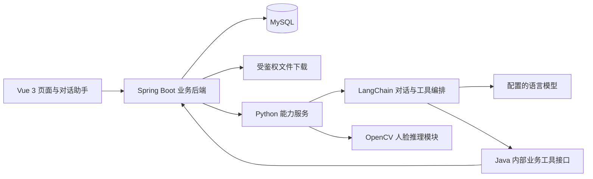

# 人脸识别考勤系统优化与 AI 助手建设计划书

编制日期：2026-10-23
状态：规划稿，尚未实施。文中的功能、工期、指标均为拟定范围与验收目标，不代表已经实现或测得。

## 一、建设目标与范围

在现有本科毕设基础上，完善为一套能够演示完整企业考勤流程的系统：员工扫脸打卡、申请请假与补卡，主管审批，管理员配置规则并生成报表；各角色可以通过 AI 对话使用自己有权使用的功能。

目标用户与主要问题：

| 用户 | 当前问题 | 改造后的能力 |
|---|---|---|
| 员工 | 打卡结果缺少解释，异常后没有完整处理流程 | 查看个人日历、了解迟到原因、申请请假和补卡、导出个人记录 |
| 部门主管 | 逐页筛选记录，审批和统计割裂 | 处理待办、查看部门异常、通过对话查询并导出部门报表 |
| 管理员/考勤管理人员 | 规则简单，报表只有原始数据，权限与运行保障不足 | 管理工作日和班次、复核月报、维护权限与识别服务 |

保留 Vue 3、Vite、Element Plus、Pinia、Java、Spring Boot、MyBatis-Plus、MySQL、Sa-Token、ECharts、高德地图及现有 Excel 技术。第一轮以 Java 8 / Spring Boot 2.7.5 兼容为约束，不将全栈升级作为前置条件；后续依赖安全维护单独评估。

新增 Python 能力服务，承担 LangChain 工具编排及本地人脸推理。新增第二语言的理由是：既需要用户提出的 LangChain，又需要可脱离云接口运行的人脸推理；不是为了只转发一次模型请求。

首版不做工资结算、多租户 SaaS、复杂轮班、硬件门禁、自动处罚、多 Agent、模型训练、知识图谱。真实企业上线、人脸防伪等级和商业使用授权不作为个人演示版已达成的结论。

## 二、已有基础与必须先处理的问题

现有基础包括三类角色、部门和人员档案、密码登录、人脸采集与打卡、请假状态编辑、公告、统计和通用导入导出。代码已具备业务扩展基础，但需先修复以下问题，才能向 AI 开放工具。

| 优先级 | 工作项 | 具体处理与验收 |
|---|---|---|
| P0 | 日期限制 | 处理 `CorsConfig.java` 与 `request.js` 中固定时间戳判断；跨域改为配置允许的前端来源。当前日期下正常请求，不再因固定日期返回登录页 |
| P0 | 后端权限 | 登录校验之外增加角色、操作和数据范围校验，覆盖列表、详情、修改、审批、导入导出、下载和 AI 工具；隐藏按钮不能代替接口鉴权 |
| P0 | 账号安全 | 自助注册不能提交任意角色；重置密码必须有可信验证或管理员权限；更新个人信息使用字段白名单和服务端身份，修复错误分支未返回的问题 |
| P0 | 数据暴露 | 普通用户响应不返回密码哈希、人脸原图、特征和内部凭据；用户选择器只返回必要字段；导出、下载均恢复鉴权 |
| P0 | 凭据管理 | 腾讯云等服务密钥迁出源码，提供配置样例；现有硬编码凭据若仍有效，应由账户所有者轮换，文档不复制密钥 |
| P0 | 事务与一致性 | 核心业务表迁至 InnoDB；账号与员工档案的新增、停用、更新有事务边界；保留历史考勤，避免删除档案留下不明记录 |
| P0 | 人脸异常处理 | 明确未录入、无人脸、多人脸、低质量、不匹配、服务不可用等结果；失败不写考勤，不读取不存在的分数 |
| P1 | 代码结构 | 将 `WebController` 中的人脸、打卡规则、落库逻辑移到对应 Service；请求 DTO 与数据库实体分离；前端复用摄像头组件 |
| P1 | 可运行性 | 修正接口文档扫描包、资源引用和未声明变量；清理失效入口；补充启动说明、日志、健康检查和必要测试 |

迁移前备份旧库及上传文件，使用副本验证。日期限制、人脸云调用异常、浏览器摄像头权限、地图定位异常要分别诊断，不能都归结为“腾讯云过期”。

## 三、拟新增的业务功能

### 3.1 考勤主流程：首版必做

1. **个人考勤日历**：按日展示应出勤、签到、签退、迟到、早退、缺卡、请假；点击日期查看依据和处理记录。
2. **明确签到与签退**：由服务端按照班次、时间窗口及已有记录决定允许的动作；明确处理重复点击、并发提交和请求重试。
3. **工作日历与班次规则**：首版先支持固定日班、周末、管理员维护的节假日及调休、宽限时间、部门适用规则。夜班与跨天班次后续扩展。
4. **补卡申请与审批**：员工选择日期、缺失动作、原因和附件，主管审批；原始打卡不覆盖，补卡形成可追溯的纠正记录。
5. **请假流程完善**：增加开始与结束时间、请假时长、审批人、审批时间、意见和状态历史；时长由规则计算，检查时间倒置与重叠申请。首版只支持按日及半日请假，规则写明后再扩展小时制。
6. **待办中心**：员工查看申请进度，主管查看待审批和缺卡待处理，管理员查看报表任务及识别服务状态。首版使用站内消息，不接短信或企业聊天平台。

日结果生成规则：以工作日历确定应出勤，再结合班次、有效打卡、已通过请假和补卡计算。请假申请被批准或补卡通过后，重新计算对应日期。规则有版本和生效日期，不能修改规则后悄悄重算所有历史记录。

### 3.2 报表中心：AI 操作的业务基础

| 报表 | 内容 | 使用范围 |
|---|---|---|
| 个人明细 | 日期、应出勤、签到、签退、迟到/早退分钟、缺卡、请假、补卡、结论 | 本人 |
| 部门月报 | 员工出勤日、请假日、异常次数、缺卡次数及明细 | 当前有权管理该部门的主管 |
| 全员汇总 | 按部门、员工、月份筛选的汇总和明细 | 有报表权限的管理员 |

首版导出 XLSX，包含“汇总”“明细”“统计口径”工作表；沿用 Apache POI / Hutool。支持中文列名、冻结表头、筛选、适当列宽，文本单元格避免被解释为公式。CSV 为后续可选项，PDF 不进入首版。

报表由 Java 按统一规则计算，AI 只负责选择条件及解释结果，不计算出勤天数、不生成虚构数据、不决定谁能看哪些员工。导出结果注明生成时间、查询区间、规则版本和是否含未结算日期。

业务时间使用 Asia/Shanghai。进行中的当日不提前记缺勤；存在请假、缺卡等未处理记录时展示“待核对”，不直接判定为旷工。“缺勤日”“缺卡次数”“迟到分钟”分别定义，不能混算。

导出做成任务：提交 → 排队 → 生成 → 成功/失败/取消；有进度、结果有效期、重试上限和下载记录。首版用 MySQL 任务表与有界执行器、租约恢复，不立即增加 Redis 或消息队列。

### 3.3 数据统计与解释

沿用 ECharts，增加个人月历、部门异常趋势、异常类型分布和待处理数量。所有统计与报表共用计算口径。

AI 可以生成“本月迟到较上月增加”的文字解读，但必须基于实际统计返回数值，并提供筛选条件和明细入口。没有可靠证据时不得推断员工动机或工作态度。

## 四、AI 助手设计

### 4.1 首版对话能力

| 用户说法 | 系统行为 | 首版范围 |
|---|---|---|
| “我这个月迟到了几次？” | 查询本人当月汇总，列出日期并链接记录 | 必做 |
| “为什么昨天显示早退？” | 查询该日班次、签退及规则版本，解释判定 | 必做 |
| “导出上个月技术部考勤报表” | 解析区间和部门，校验范围，展示任务并生成文件 | 必做 |
| “只要迟到和缺卡的，按员工汇总” | 在当前会话条件上修改筛选，再生成报表 | 必做 |
| “列出我需要审批的申请” | 返回当前用户有权处理的待办 | 必做 |
| “帮我请下周一一天假” | 缺少类型、原因时询问，生成请假草稿，确认后提交 | 首版后半段 |
| “昨天忘记签退，帮我补卡” | 收集目标日期、时间和原因，生成待确认草稿 | 首版后半段 |
| “考勤制度怎么规定？” | 优先检索已发布的制度，回答附来源及生效版本 | 第二版 |
| “把这些请假都批了” | 展示有权审批的具体申请及拟操作，逐项/批次确认后执行 | 第二版，首版导航到审批页 |

“各种功能”通过受控业务工具逐步覆盖，不直接向模型提供任意 SQL、任意 HTTP 请求、文件系统或系统命令权限。工资、权限配置、人脸模板修改和直接改写考勤结论不开放为首版 AI 工具。

### 4.2 技术路线与兼容性

**推荐：保留 Java 8 + Spring Boot 2.7，新增 Python FastAPI + LangChain。**

当前 LangChain4j 官方文档要求最低 JDK 17，其 Spring Boot starter 有对应的框架版本要求，不能直接放进本项目现有版本。[官方入门](https://docs.langchain4j.dev/get-started/)、[Spring Boot 集成](https://docs.langchain4j.dev/tutorials/spring-boot-integration/)。

备选路线是后续统一升级 JDK / Spring Boot，再评估 LangChain4j；它适合希望长期只维护 Java 的情况，但本次不同时承担框架迁移和业务改造。也不为规避兼容性使用未经核验的旧版框架。

LangChain 用于模型接入、结构化参数、工具选择、多轮上下文和执行结果整理。单一 Agent 即可；运行库可能间接使用 LangGraph，但首版不另建复杂图工作流或独立编排平台。[工具文档](https://docs.langchain.com/oss/python/langchain/tools)。

模型通过配置选择支持工具调用和结构化输出的服务；实施时用中文日期解析、工具准确率、延迟和费用做小样本对比，再确定并锁定型号。模型缺失或故障时，页面查询、人工审批、报表与本地人脸打卡仍应可用。

### 4.3 模块与权责

| 所有权 | 负责方 |
|---|---|
| 用户、登录、角色、部门数据范围、授权与审批 | Java |
| 业务事实、规则计算、事务、报表、任务及文件权限 | Java |
| 会话、工具执行记录、确认单和审计的持久存储 | Java / MySQL |
| 模型提示词、工具选择、短期上下文组装 | Python / LangChain |
| 人脸检测、对齐、特征提取及比对计算 | Python / OpenCV |
| 人脸模板的登记、版本、撤销与存储 | Java；Python 不直连业务库 |
| 第二版制度知识源、权限和索引版本登记 | Java；Python 可维护可重建的派生检索索引 |

先在一个 Python 部署单元中分开聊天与人脸模块，配置独立并发上限和超时，避免聊天或 CPU 推理占满资源。若实测相互影响，再拆进程或服务；不提前引入多个微服务。

增加一个 Python 环境、模型文件和进程是这条路线的运维代价，需要提供项目内依赖锁定、配置、启动、健康检查和故障定位说明。

### 4.4 工具清单与执行规则

首版业务工具拟定为：

| 工具 | 参数示例 | 服务端约束 |
|---|---|---|
| `query_attendance_summary` | 起止日期、部门筛选 | 数据范围由 Java 计算，员工只能查本人 |
| `query_attendance_details` | 日期、异常类型、分页 | 限制区间、页大小和可见字段 |
| `explain_attendance_day` | 目标日期、员工筛选 | 返回规则版本和依据，校验目标员工可见性 |
| `create_attendance_export` | 已校验条件、报表类型 | Java 生成任务，导出和下载都检查权限 |
| `get_export_status` | 任务编号 | 检查任务归属和当前权限 |
| `list_pending_applications` | 类型、分页 | 只返回当前可处理事项 |
| `prepare_leave_application` | 日期、类型、原因 | 只生成草稿，不视为已经提交 |
| `prepare_correction_application` | 日期、动作、时间、原因 | 检查可申请范围及是否重复 |

执行流程：用户消息 → Java 验证身份 → 传入可信上下文 → 模型选择工具与结构化参数 → Java 再次检查参数、身份与权限 → 执行业务 → 返回结构化结果 → 展示说明、记录链接或文件卡片。

重要约束：

- 浏览器只访问 Java。Python 服务不直接对公网开放，内部调用有服务身份验证。
- Java 为一次助手运行签发短期、受限委派凭证，绑定当前用户、会话、运行编号和工具范围；凭证通过服务调用上下文传递，不进入提示词或工具参数，也不交给模型决定。
- 每次工具调用在 Java 重新检查会话有效性、账号状态、角色与部门范围；服务身份不等于可以读取全部数据。
- 模型不提供可信的 `userId`、`role`、`allowedDeptIds`；它提出的部门只是筛选条件，不能扩展服务端允许范围。
- “技术部”“上个月”“最近”等表达需规范化。重名部门、多个人名及不明确时间先澄清；明确日期后展示绝对起止日期。
- 普通只读查询可直接执行；明确要求且条件完整的授权导出可直接建任务，并展示实际范围；有歧义或范围较大时先展示导出预览。
- 请假、补卡提交使用 Java 持久化确认单，绑定操作者、规范化参数、版本、有效期及一次性确认编号。前端确认后由 Java 执行；模型说“已经确认”不具有授权效力。
- 请求、确认和任务使用幂等编号；重复网络请求不重复创建同一业务记录。用户明确要求重新生成报表时允许创建新版本。
- 单轮先设工具调用上限 5 次、总运行上限 60 秒，作为可调初值；超时返回实际执行状态，已创建的导出任务可以继续查询。
- 对外部调用区分可重试查询和有副作用操作。没有成功回执时先查询结果，不盲目重试写操作。
- 会话按用户隔离；不跨用户复用记忆，不把口令、人脸模板或无关员工原始记录发送给语言模型。

流式输出采用 Java 代理的 SSE 或同等事件通道，支持“正在查询”“任务已创建”“等待确认”“失败/取消”等状态。实施时兼容 Bearer 请求头，不把访问令牌拼入 URL；客户端断线后依据任务编号恢复结果，不自动重复写操作。

### 4.5 第二版制度问答

只有需要依据制度文档回答时再增加 RAG。先支持管理员维护的已发布制度和公告，展示出处、段落、版本、生效日期；没有依据时明确无法确认，并链接原文。

小规模文档先评估数据库关键词检索；确有语义检索收益时，再使用持久化、可重建的向量索引。制度文本属于不可信检索材料，其中“忽略权限”“调用工具”等文字不得变成系统指令。实时考勤统计始终查业务接口，不从向量库推算。

## 五、腾讯云识别问题与替换方案

### 5.1 目前能确认什么

代码使用腾讯云 `iai.tencentcloudapi.com` 的 `CompareFace`，并把凭据硬编码在 `FaceContrastServer.java`。本次没有调用现有密钥、登录腾讯云控制台或查看账单，因此**没有确认该账户是否欠费、资源包到期、密钥失效或服务停用**。

腾讯云官方仍提供 CompareFace，当前 API 版本仍为 `2020-03-03`。版本日期旧不等于接口过期。其计费文档说明部分服务有月度免费额度，但具体账户权益和余额需在控制台核实。[接口文档](https://cloud.tencent.com/document/api/867/44987)、[计费说明](https://cloud.tencent.com/document/product/867/17640)。

实施阶段排查顺序：

1. 先修复前后端日期限制，确认请求能够到达后端。
2. 从受控日志记录云端错误码及请求编号，区分凭据/签名、权限、账户计费、限流、网络和图片参数问题；不记录完整图片或密钥。
3. 由账户所有者确认产品开通状态、可用地域、资源包和账单，以及密钥是否有效；不能仅凭年份判断失效。
4. 核对图片内容：Canvas 生成的 `data:image/png;base64,...` 要转换为接口要求的纯 Base64，检查格式、大小和人脸质量。
5. 核对 SDK 返回的分数类型，统一为明确的数值 DTO；错误时停止判断，避免空值或错误类型转换。

### 5.2 方案比较与推荐

| 方案 | 优点 | 代价与限制 | 建议 |
|---|---|---|---|
| 修复并继续腾讯云 | 复用 SDK，计算负载小 | 依赖账户、网络、额度及费用；服务变化仍需维护 | 保留为可选 Provider |
| 本地 OpenCV YuNet + SFace | 初次准备模型后可离线推理，不产生云接口调用费；便于演示与测量 | 需要维护运行环境、权重和阈值；实际精度及 CPU 耗时需测试 | 默认建设路线 |
| 本地 InsightFace | 可作为效果对比候选 | 官方预训练权重有使用范围约束，不能把代码开源等同于权重可任意商用 | 暂不作为默认 |
| 自训识别模型 | 可研究算法 | 数据、训练和评测成本高，与当前完善业务的目标不匹配 | 不进入本计划 |

OpenCV 官方提供 YuNet 检测、对齐和 SFace 特征比对示例。[官方教程](https://docs.opencv.org/4.x/d0/dd4/tutorial_dnn_face.html)。当前模型目录内 YuNet 标注 MIT、SFace 标注 Apache-2.0；实施时锁定具体权重来源、提交版本、哈希和许可证副本，并单独核验使用条件，不仅查看 OpenCV 库本身的许可。[YuNet 许可](https://raw.githubusercontent.com/opencv/opencv_zoo/main/models/face_detection_yunet/LICENSE)、[SFace 许可](https://raw.githubusercontent.com/opencv/opencv_zoo/main/models/face_recognition_sface/LICENSE)。InsightFace 官方区分代码许可与预训练权重使用范围。[模型说明](https://github.com/deepinsight/insightface/blob/master/python-package/docs/model_zoo.md)。

### 5.3 改为“当前账号 1:1 验证”

当前已经要求员工登录，却仍遍历全部用户进行人脸匹配。这增加请求次数，也扩大误匹配和数据处理范围。推荐改为：

登录用户 → 获取本人有效模板 → 校验打卡会话与图片 → 本地检测唯一人脸 → 对齐与提取特征 → 与本人模板比较 → Java 执行考勤规则并落库。

人脸计算结果返回明确的 Provider、模型版本、分数、阈值版本、质量状态和耗时；匹配不能直接代表考勤成功，是否可在此时、此地点、以此动作打卡仍由 Java 决定。

腾讯云的分数阈值 80 不能照搬到本地模型。SFace 的余弦相似度与云端分数不是同一量纲；按自愿采集样本的同人/异人比对分布确定阈值，并保留独立测试集。

### 5.4 采集、存储及迁移

- 新采集使用统一摄像头组件和清晰画面，不再固定只截取 200×200 的图片；引导正脸、适当光照、单人入镜，检测模糊和过小人脸。
- 采集多张合格样本，登记模型和模板版本；特征同样属于敏感数据，受权限、加密和删除策略保护，不作为公开演示数据。
- Java 保存模板和版本，Python 接收受控输入完成计算，不拥有业务库账号。运行时可将必要模板通过内部接口传递，不发给聊天模型。
- 旧 `sys_user.face` 先保留于迁移副本，尝试解码、质量检查并生成新模板；不合格者标记“需要重新采集”，不直接丢弃旧数据或默认迁移成功。
- 默认不长期保存每次打卡原图；调试样本需明确用途、访问范围和清理期限。模板删除、撤销、更换留审计记录。
- 设计 `FaceVerificationProvider`，可配置 `local` 或 `tencent`。不在失败时静默切换并上传图片到另一提供方；切换需明确配置，并记录实际 Provider。

### 5.5 防伪及位置边界

首版加入一次性打卡会话、有效期、请求绑定和重放拦截；但这些只能约束请求流程，不能证明摄像头前是真人。眨眼或转头交互也不能直接宣称具有可靠活体检测能力。

第二版独立评估活体检测与照片、屏幕回放、视频重放测试。没有通过相应测试前，明确标注为个人演示版，不用于高风险门禁或工资扣罚依据。

高德定位仍保留，前端提交结构化经纬度和精度，Java 计算距考勤点的距离、检查允许范围和定位结果时效。浏览器坐标可能被伪造，因此不能宣称完全防异地代打卡。定位失败、精度不足或识别服务不可用时，进入明确的失败提示和人工补卡流程，不直接放行。

## 六、数据与接口改造

以下为逻辑实体，实施时优先扩展现有表；不会为了清单完整一次创建全部空表。

| 模块 | 拟新增/调整实体 | 核心内容 |
|---|---|---|
| 人员组织 | 现有员工、部门、用户及有效期记录 | 停用、部门变更时间、关联一致性 |
| 考勤 | 班次、工作日历、打卡事件、日汇总 | 原始事件不可随意覆盖，业务日期、动作、规则版本、幂等号 |
| 审批 | 请假申请、补卡申请、审批历史 | 正式状态迁移、版本号、处理人、前后状态 |
| 人脸 | 模板、验证记录 | 加密特征、模型版本、撤销、验证错误码；避免保存无必要的原图 |
| 报表 | 导出任务及文件元数据 | 查询条件、数据快照/版本、生成者、授权范围、租约、过期时间 |
| AI | 会话、消息、工具运行、确认单 | 用户归属、请求编号、参数摘要、耗时、状态及确认凭据 |
| 审计 | 操作日志 | 谁、何时、对什么对象、从什么状态变为什么状态、是否来自 AI |

人员调动后的历史数据规则需明确：考勤事件保留当时部门快照；主管当前身份决定其可管理部门，查询再以历史部门归属筛选，不能因为员工调入就自动获得其原部门记录。

导出创建、执行和下载均重新验证范围。排队期间权限缩小则停止或重新确认；下载时再次校验当前授权，不因为曾经生成文件就永久可下载。报表使用一致的数据快照或可复核版本，包含未结算日期时明确标注。

普通业务接口、AI 工具和导出必须共用 Service 与权限策略。原始记录、计算汇总、AI 文字解释分别存储；AI 文本不能反写成为业务事实。

## 七、实施阶段与交付顺序

工期为单人借助 AI 开发的初步工作量估算，需结合实际环境修正；建议按每周 15～20 小时预留约 6～8 周。首版约 100～145 小时，第二版功能另估，不同时开工所有可选项。

| 阶段 | 估算 | 工作与交付 | 完成门槛 |
|---|---|---|---|
| 0. 基线恢复 | 10～15 小时 | 旧库备份、可重复启动、日期限制与主要权限修复、配置隔离 | 三角色可登录，关键越权请求被拒绝 |
| 1. 人脸替换 | 15～20 小时 | Provider 接口、本地识别、1:1 验证、采集与模板迁移、错误提示 | 断开云人脸接口后可用本人样本完成打卡 |
| 2. 考勤闭环 | 25～35 小时 | 日班与工作日历、签到签退、请假与补卡、审批历史、个人日历 | 缺卡 → 申请 → 审批 → 重新计算可复现 |
| 3. 报表中心 | 15～20 小时 | 统一统计口径、个人/部门报表、异步任务、鉴权下载 | 报表与页面一致，失败可追踪，重启可恢复 |
| 4. AI 助手 | 25～35 小时 | 只读工具 → 对话导出 → 确认式申请，流式事件、审计及评测 | 对话导出与页面导出走同一业务逻辑 |
| 5. 验证交付 | 10～20 小时 | 权限与并发验证、AI 和人脸评测、演示数据、部署说明 | 关键流程有记录、可复现并说明限制 |

最先做出的 AI 演示应是：“主管说一句话 → 导出本人有权访问的部门月报 → 点击下载”。先完成这一条，再扩展自然语言申请和制度问答。

第二版候选顺序：制度问答及来源引用 → 批次审批确认 → 高级活体检测 → 多班次/跨天考勤 → 按实测瓶颈引入缓存或消息队列。暂不加入自动发邮件、自动对外通知或公开部署。

## 八、验收与工程证据

### 8.1 功能与权限

- 员工不能查看或导出他人记录；主管不能访问非管理部门；管理员权限按明确操作配置。
- 同一规则和数据下，页面、报表、AI 工具返回的数值一致；AI 解释附可打开的记录或规则依据。
- 两次并发审批只有一个有效状态迁移；重复点击打卡或确认不生成重复业务事实。
- 未批准请假不抵扣应出勤；申请通过后只重算受影响日期；历史规则不因配置变更被静默覆盖。
- AI 会话与下载文件不能跨用户访问；提示词要求“忽略权限”或伪造部门编号不会扩大范围。

### 8.2 AI 固定评测集

建立至少 60 个固定案例，包含日期歧义、部门重名、跨用户越权、提示注入、导出、重复确认、模型超时和无数据。调试集与最终保留集分开。

验收目标：保留集中授权任务正确完成率至少 90%；固定越权案例无越权执行；固定重复提交案例无重复业务记录；所有执行型结果可关联工具记录。这里的“无”仅描述指定测试集，不能宣传为普遍零风险。

同时报告工具选择、参数解析、权限拒绝、任务成功各环节结果、平均 token 用量与费用。故障时显示实际失败步骤，不把失败工具结果包装成成功回答。

### 8.3 人脸评测

经参与者同意后，建议至少 10 人、不同时间与光照采样，按采集会话划分模板、阈值校准与独立测试样本。记录同人通过、异人误接收、正常样本误拒、无人脸、多人脸及照片/回放攻击结果。

首版目标是基本受控演示场景可用；先测量再决定是否达到目标阈值，不预填“99%准确率”。小样本不能证明企业生产精度。记录 CPU、分辨率、模型版本、样本数、阈值和 p50/p95 耗时。

### 8.4 任务恢复与降级

验证报表任务生成时进程重启、租约到期、重复调度、文件已生成但状态未提交、取消和过期清理。数据库任务状态与文件提交须可核对，不能只测试顺利导出。

AI 不可用时人工业务正常；本地识别不可用时不伪造打卡成功；腾讯云未配置时不触发隐藏上传；模型和服务超时有明确提示。

最终交付包括 README、配置示例、迁移与回退步骤、脱敏演示数据、关键请求链路、接口说明、设计取舍、测试与评测记录、5～10 分钟演示脚本。源码复用和模型来源保留说明；简历只写届时已实现且有证据的内容。

## 九、建议确认的实施默认值

本计划按以下默认值编排，可在开发前按需要调整，不阻塞本次计划交付：

1. Vue 与 Java 现有技术保持，Python 仅承接 LangChain 和人脸计算。
2. 本地 OpenCV 识别作为默认，腾讯云保留可配置接口；不以充值作为恢复演示的唯一条件。
3. 先做单组织、固定日班、日/半日请假、一级主管审批，避免首版被复杂排班拖长。
4. AI 首版重点是查询、解释、导出和申请草稿；审批写入在第二版推进。
5. 开发开始前确定可用语言模型的提供方和预算、人脸评测参与者及原库备份位置。缺少模型密钥可以继续开发普通业务，并使用清楚标注的 Mock 验证接口，不把 Mock 计作真实 AI 效果。

## 十、资料核对与结论边界

官方资料核对日期为 2026-10-23，链接见各相关章节。外部依赖正式实施时再次核对兼容版本、许可与服务条件，锁定版本，不能直接照搬动态文档的最新示例。

本次仅新增计划书；未改动业务源码、数据库或凭据，未安装依赖，未调用腾讯云现有账号或创建付费资源。腾讯云账户状态仍待实际错误码或账户侧证据确认。
